# Medicare Claims Analysis - PostgreSQL + Python

Who are Medicare beneficiaries, what drives their cost, and how is hospital care used? I loaded 857K synthetic Medicare claims into PostgreSQL, answered 24 questions in SQL (DBeaver), and charted the main results in Jupyter.

**Tools:** PostgreSQL, DBeaver, SQL, Python (pandas, matplotlib, SQLAlchemy), Jupyter

## Key Findings

- **Chronic conditions drive cost.** Average yearly Medicare payment goes from $270 for someone with none of the 11 tracked conditions to $30,091 for someone with all 11.
- **Diabetic beneficiaries cost 4.6x more:** $7,908 a year vs $1,720. Most of the gap is hospital stays.
- **Spending is concentrated.** About 11% of beneficiaries account for about 60% of the money. About 20% cost nothing that year.
- **10.1% of hospital admissions** were followed by another admission within 30 days.

<p align="center">
  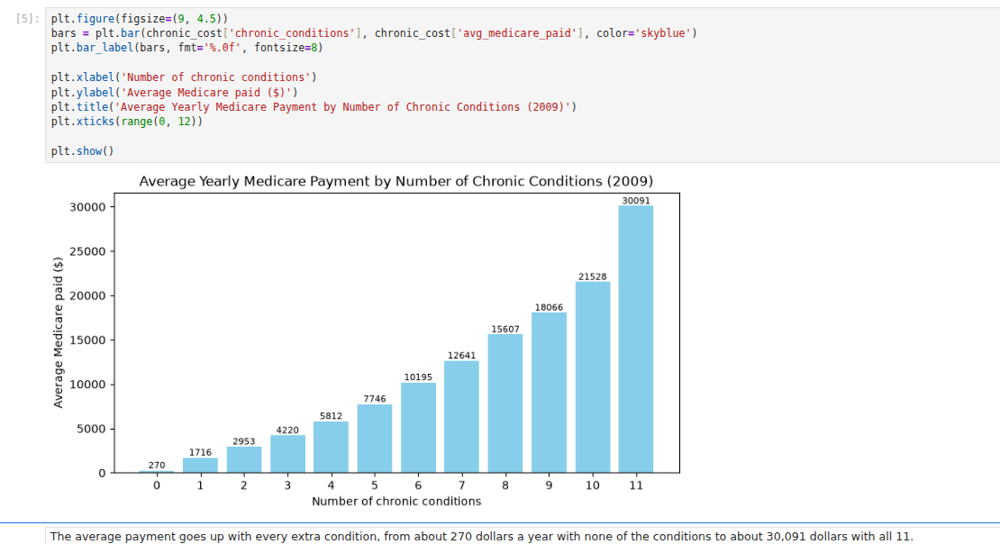
</p>

## How I Worked

1. **PostgreSQL:** loaded the four CMS files into six tables with primary and foreign keys (`create_tables.sql`, `load_data.sql`).
2. **DBeaver:** wrote and tested all 24 queries (`medicare_claims_analysis.sql`).
3. **Jupyter:** connected Python to the same database, re-ran the key queries with `pd.read_sql`, and plotted them (`medicare_claims_charts.ipynb`).

## Data

[CMS 2008-2010 DE-SynPUF](https://www.cms.gov/data-research/statistics-trends-and-reports/medicare-claims-synthetic-public-use-files), Sample 1. CMS built this from real claims and then changed it to protect privacy, so the structure, codes and payment fields are realistic but the people are not.

<p align="center">
  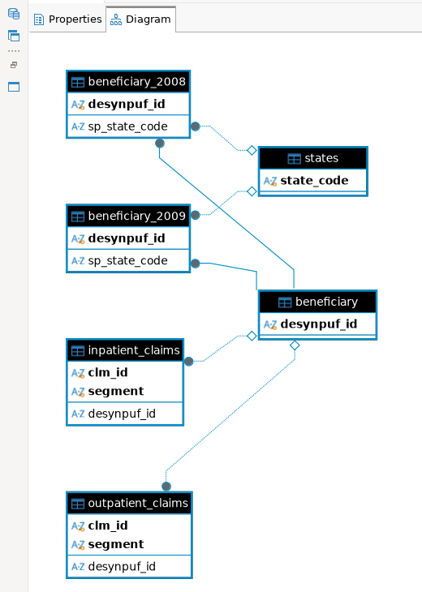
</p>

| Table | Rows | Primary key | Links to |
|---|---:|---|---|
| `beneficiary` | 116,352 | `desynpuf_id` | one row per person |
| `beneficiary_2008` | 116,352 | `desynpuf_id` | `beneficiary`, `states` |
| `beneficiary_2009` | 114,538 | `desynpuf_id` | `beneficiary`, `states` |
| `inpatient_claims` | 66,773 | `clm_id` + `segment` | `beneficiary` |
| `outpatient_claims` | 790,790 | `clm_id` + `segment` | `beneficiary` |
| `states` | 52 | `state_code` | lookup for the SSA state codes |

What needed fixing in the raw files:

- `clm_id` is not unique (10,975 repeats in outpatient, 68 in inpatient), so the primary key is `clm_id` plus `segment`.
- Dates come as text like `20090312` and missing values as empty strings. `load_data.sql` loads everything as text first, then converts with `TO_DATE` and `NULLIF`.
- Demographics repeat in both yearly files, so I moved them into one `beneficiary` table.
- The chronic condition flags use `1 = yes` and `2 = no`, not 1/0. Adding them up directly gives wrong counts, so the queries check `= 1`.

<p align="center">
  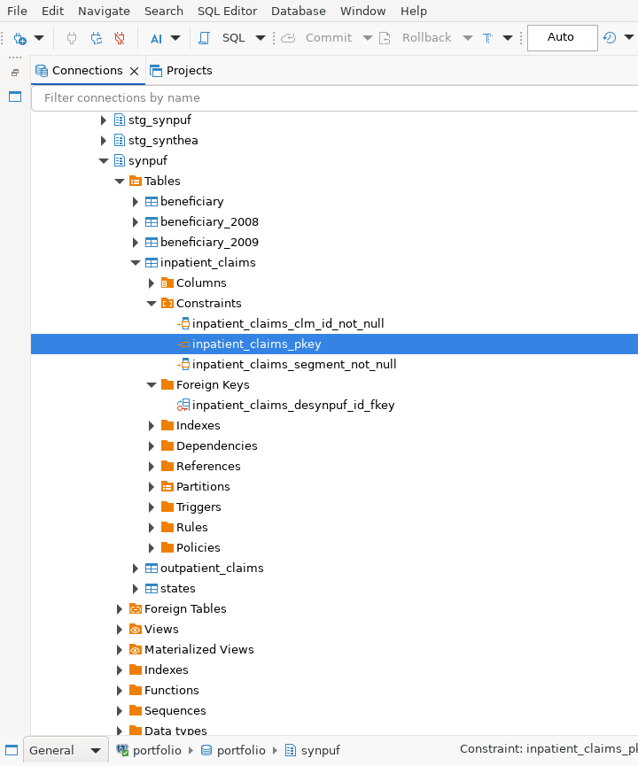
</p>

## Analysis

### 1. Cost by number of chronic conditions

A CTE counts the 11 condition flags for each person, then the outer query averages their total payment (inpatient + outpatient + physician) for each count.

<p align="center">
  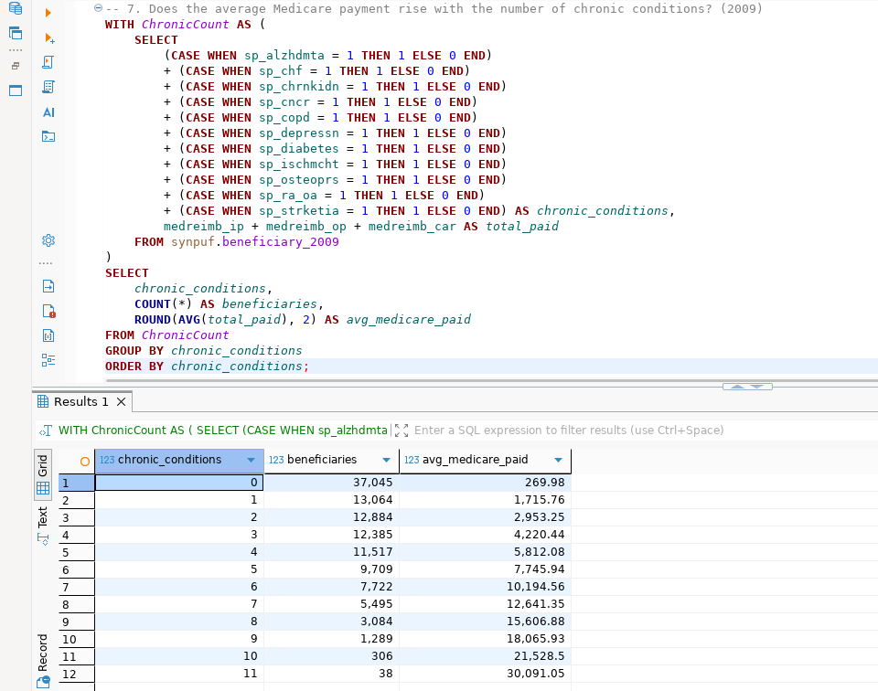
</p>

Cost rises at every step: $269.98 with no conditions, $5,812.08 with 4, $15,606.88 with 8, $30,091.05 with 11. The chart is at the top of this page.

### 2. Diabetic vs non-diabetic beneficiaries

<p align="center">
  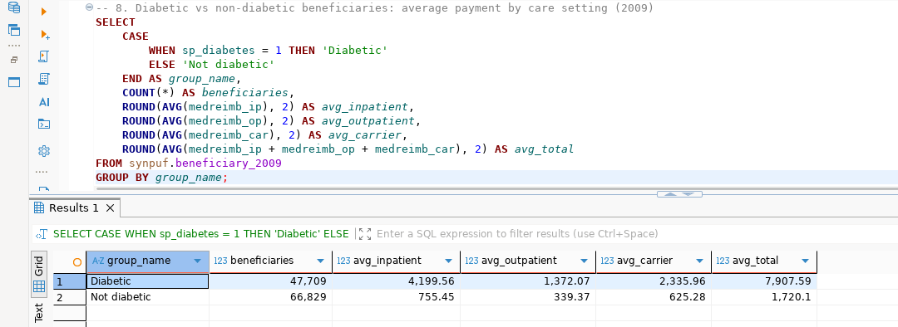
</p>

<p align="center">
  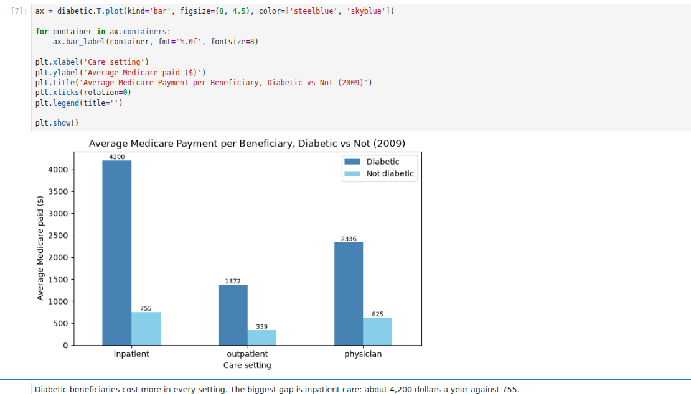
</p>

$7,907.59 vs $1,720.10 a year. Inpatient care is the biggest gap: $4,199.56 vs $755.45.

### 3. How concentrated is spending?

<p align="center">
  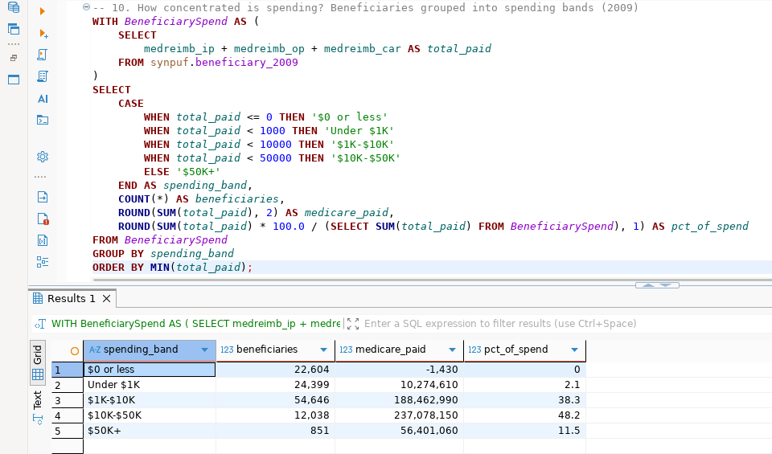
</p>

<p align="center">
  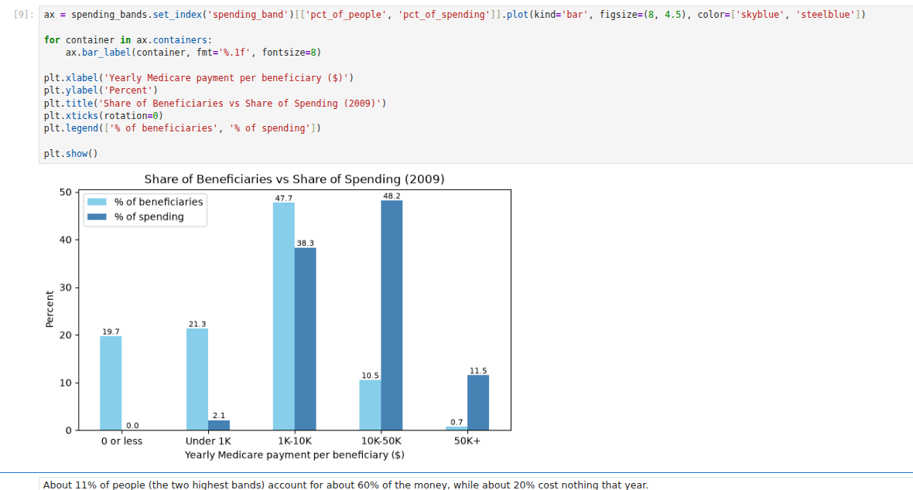
</p>

The 12,038 people in the $10K-$50K band account for 48.2% of 2009 spending, and the 851 people over $50K another 11.5%.

### 4. 30-day readmission rate

For each hospital stay, I checked whether the same person was admitted again within 30 days of discharge. The CTE joins `inpatient_claims` to itself, and a `LEFT JOIN` back to all admissions keeps the stays with no readmission in the count.

<p align="center">
  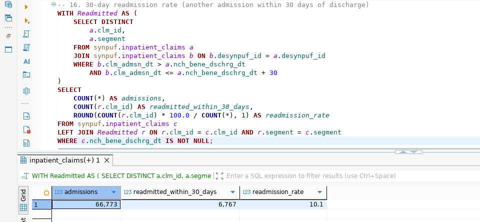
</p>

6,767 of 66,773 admissions (10.1%) were followed by another admission within 30 days.

### 5. Monthly admissions

<p align="center">
  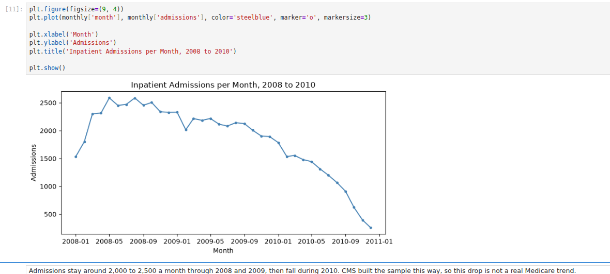
</p>

Admissions peak at 2,587 in May 2008 and fall to 257 by December 2010. CMS built the sample this way, so the drop is not a real Medicare trend.

### 6. Data quality checks

<p align="center">
  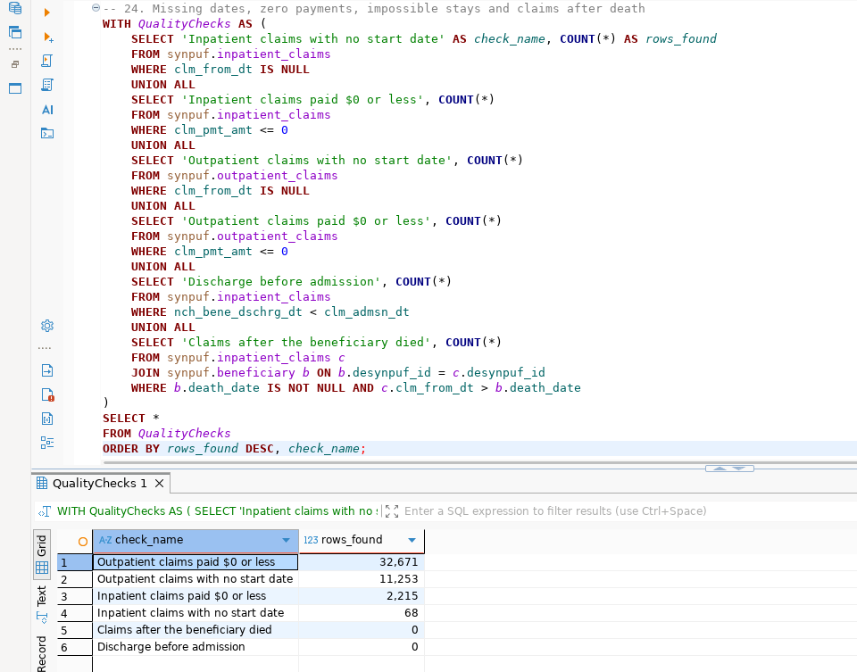
</p>

32,671 outpatient and 2,215 inpatient claims were paid $0 or less, and 11,253 outpatient claims have no start date. No discharge comes before its admission, and no inpatient claim starts after the beneficiary's death.

## All 24 Questions

| # | Question | Answer |
|---|---|---|
| 1 | How big is the data? | 116,352 beneficiaries, 66,773 inpatient and 790,790 outpatient claims, Nov 2007 to Dec 2010 |
| 2 | Sex and age? | 64,347 women (average age 73.9) and 52,005 men (71.1) |
| 3 | Race? | White 82.8%, Black 10.6%, Other 4.2%, Hispanic 2.3% |
| 4 | Age groups? | 65-74 is the largest group (46,070). 18,242 are under 65 |
| 5 | Largest states? | California 10,074, Florida 7,632, Texas 6,610 |
| 6 | Most common chronic conditions? | Ischemic heart disease 47.7%, diabetes 41.7%, heart failure 34.4% (2009) |
| 7 | Cost by number of conditions? | $270 with none, $30,091 with all 11 |
| 8 | Diabetic vs non-diabetic? | $7,908 vs $1,720 a year |
| 9 | Spending by care setting? | Inpatient 51%, physician 31.1%, outpatient 17.9% |
| 10 | How concentrated is spending? | About 11% of beneficiaries account for about 60% of spending |
| 11 | Inpatient volume by year? | 27,678 claims ($257.7M) in 2008, 25,231 ($244.8M) in 2009 |
| 12 | Monthly admissions? | Peak 2,587 (May 2008), down to 257 by Dec 2010 |
| 13 | Length of stay? | Average 5.7 days, median 4, longest 35 |
| 14 | Costliest DRGs? | DRG 939 ($3.52M over 253 claims), then 948 and 949 |
| 15 | Top admitting diagnoses? | ICD-9 786.05 shortness of breath (2,739), 786.50 chest pain (2,697), 486 pneumonia (2,363) |
| 16 | 30-day readmission rate? | 10.1% (6,767 of 66,773) |
| 17 | Top hospital by payment? | Provider 23006G: $7.28M across 772 claims and 580 patients |
| 18 | What does the patient pay? | Part A deductible $1,057 and coinsurance $90 per stay on average; Medicare pays $9,574 |
| 19 | Outpatient volume by year? | 282,896 claims in 2008 and 322,358 in 2009 |
| 20 | Most common outpatient services? | HCPCS 36415 blood draw (161,373), then 99213 and 99212 office visits |
| 21 | Busiest attending physician? | NPI 1586461282: 3,049 claims for 1,074 patients |
| 22 | Outpatient claims per person? | 31,080 had none, 40,346 had 6 to 20, 104 had more than 50 |
| 23 | Deaths? | 1,814 in 2008 and 1,784 in 2009 |
| 24 | Data quality? | See section 6 above |

## Limitations

- Synthetic data: payments are rounded to $10, and the 2010 drop in admissions comes from how the sample was built.
- `clm_pmt_amt` is the payment for the whole claim, so the average next to a HCPCS code (query 20) is not the price of that code.
- The 2010 beneficiary summary file returned an error from the CMS site, so person-level analysis uses 2008 and 2009. Claims still cover 2010.
- DRG, ICD-9 and HCPCS come as codes only. The names above are the standard descriptions for those codes.

## How I Would Extend This Project

- Add code description tables so results show names instead of codes
- Break readmissions down by diagnosis and by hospital
- Compare the readmission query with and without its index using `EXPLAIN ANALYZE`

## How to Run It

```bash
./data/download.sh                          # downloads the CMS files (about 200 MB)
createdb medicare
psql -d medicare -f create_tables.sql
psql -d medicare -f load_data.sql           # about 30 seconds
```

Then run `medicare_claims_analysis.sql` in DBeaver, and open `medicare_claims_charts.ipynb` in Jupyter. The notebook connects to `postgresql+psycopg://localhost:5432/medicare` and reads the password from `~/.pgpass`.

## Files

| File | What it does |
|---|---|
| `create_tables.sql` | Schema, primary keys, foreign keys and indexes |
| `load_data.sql` | Loads and cleans the CSV files |
| `medicare_claims_analysis.sql` | The 24 analysis queries |
| `medicare_claims_charts.ipynb` | Re-runs the key queries from Python and plots them |
| `data/download.sh` | Downloads the CMS files (the CSVs are not in the repo) |
| `query_*.png`, `er_diagram.png`, `inpatient_claims_keys.png` | DBeaver screenshots |
| `jupyter_*.png` | Jupyter screenshots |
